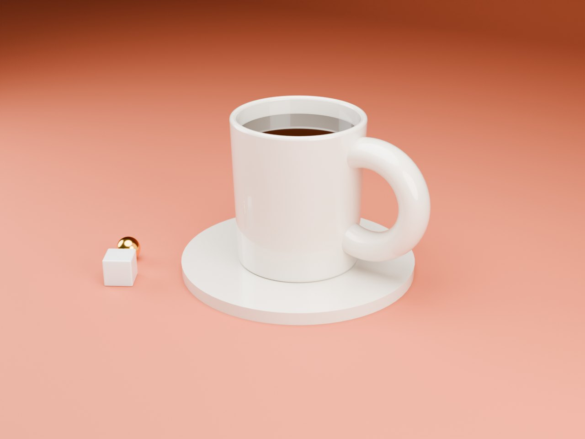
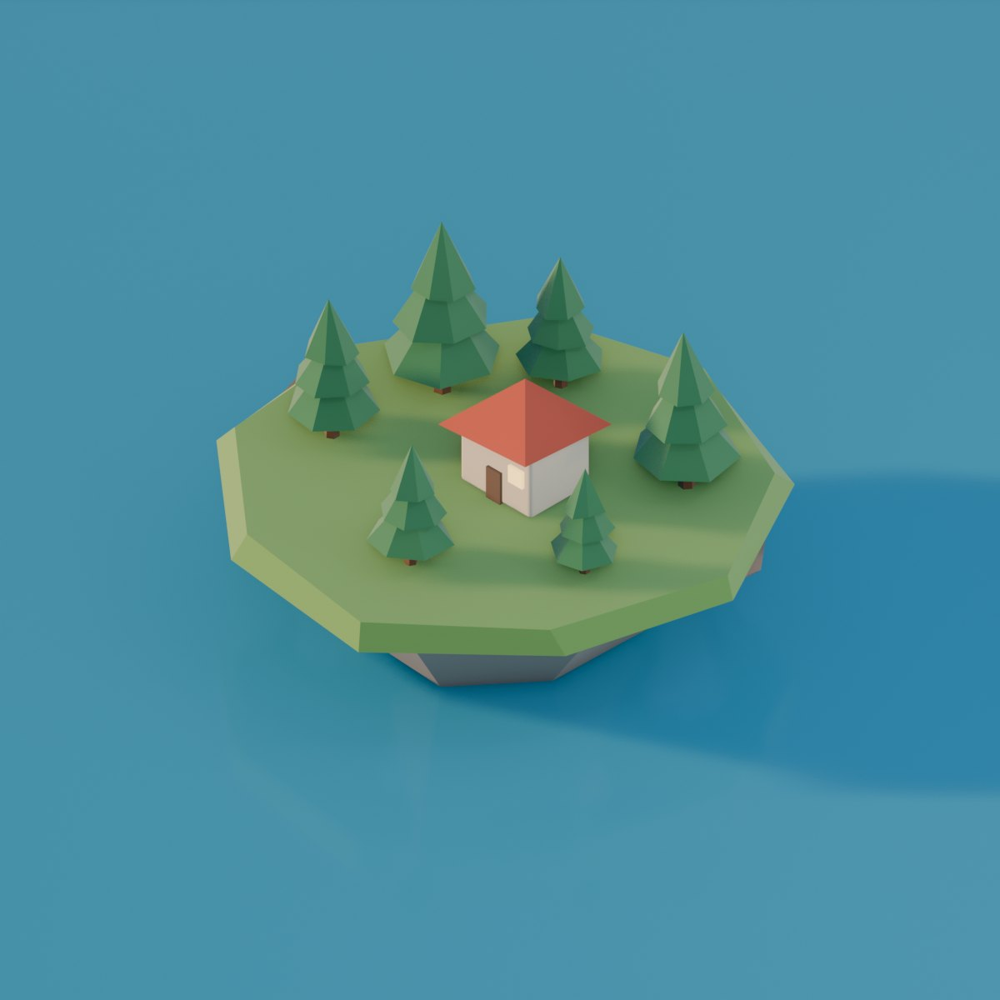
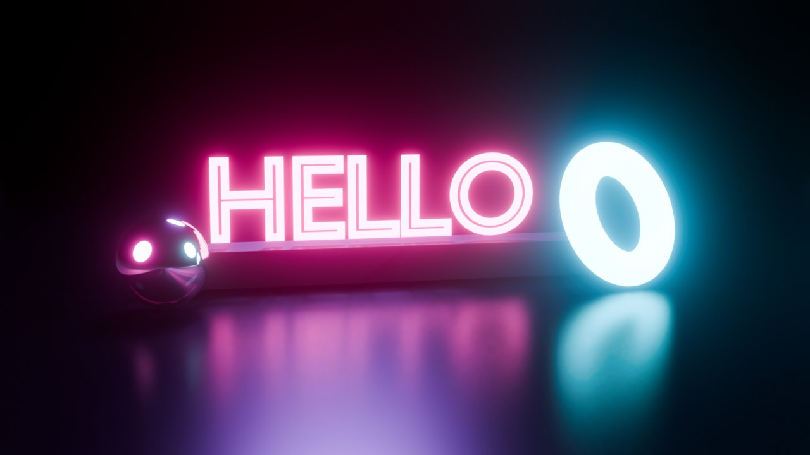
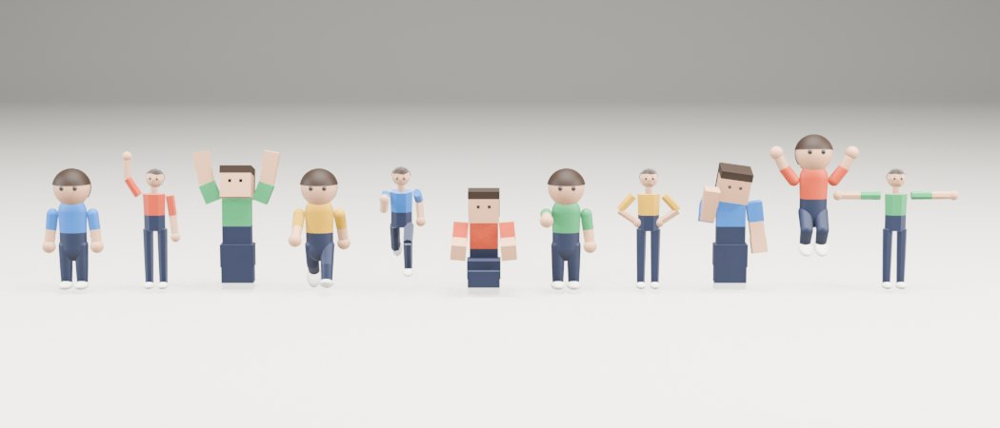
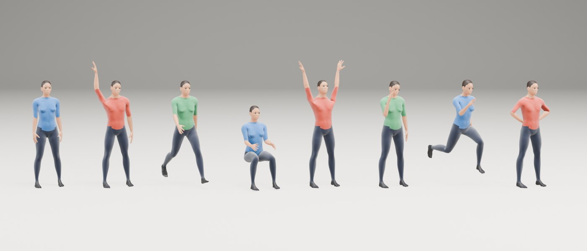
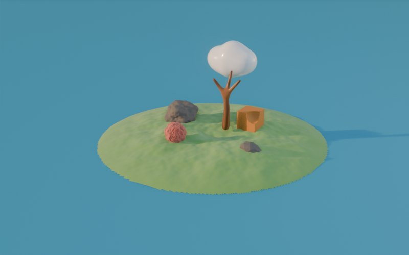
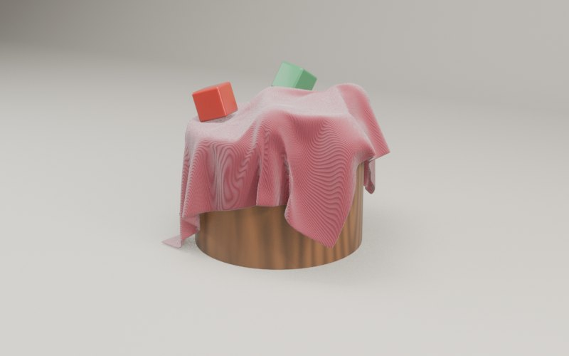

# Blender Studio MCP

Lets Claude and other AI models make good-looking 3D art in [Blender](https://www.blender.org).

Blender can already be scripted, but an AI writing raw scripts tends to produce flat, grey
"programmer art". Blender Studio gives the AI what a photographer has: ready-made lighting rigs,
real materials, a camera that frames the subject by itself, and above all the ability to
**render, look at the picture, and fix it**.

| | | |
| --- | --- | --- |
|  |  |  |

*Each picture was built and photographed using only the tools below; see `examples/showcase.py`.*

| | |
| --- | --- |
|  |  |
|  |  |

*Straight out of the test suite (`tests/motion.py`), unretouched. A sample video is in `docs/walk-and-jump.mp4`.*

- Works on macOS, Windows and Linux.
- Works with any AI app that supports MCP (Claude Code, Claude Desktop, Cursor, and others).
- Free. No account and no API key. Blender runs on your own computer.
- Blender starts by itself in the background; there is no add-on to install.

## Install

1. Install [Blender](https://www.blender.org/download/) 4.2 or newer.
2. Install [uv](https://docs.astral.sh/uv/getting-started/installation/).
3. Add the server to your AI app.

**Claude Code**

```
claude mcp add blender-studio -- uvx --from git+https://github.com/Just-Rice/blender-studio blender-studio-mcp
```

**Claude Desktop, Cursor and other apps** (add to the app's MCP settings file)

```json
{
  "mcpServers": {
    "blender-studio": {
      "command": "uvx",
      "args": ["--from", "git+https://github.com/Just-Rice/blender-studio", "blender-studio-mcp"]
    }
  }
}
```

Then ask for something: *"Make a product shot of a ceramic mug on a warm backdrop."*

## What the AI can do

| Tool | What it does |
| --- | --- |
| `create_object`, `transform_object`, `delete_objects` | Build with basic shapes |
| `run_python` | Anything else, using Blender's own scripting |
| `apply_material` | 24 realistic surfaces: ceramic, gold, glass, wood, fabric, neon and more |
| `create_rock`, `create_terrain`, `create_blob`, `create_limbs` | Natural and organic shapes: stones, hills, clouds, creatures, trees |
| `sculpt`, `boolean` | Roughen, smooth, fuse and cut existing shapes |
| `create_character` | Stylised people in three styles (toy, low-poly, blocky) with working joints |
| `create_human` | Realistic adult bodies via the free [MPFB](https://extensions.blender.org/add-ons/mpfb/) add-on, installed on first use |
| `pose_character`, `animate_character` | 11 poses (wave, sit, run...) and 6 motion clips (walk, jump, dance...) |
| `list_animations`, `play_animation` | Use the motion that comes with imported characters (Mixamo, Ready Player Me, any FBX/GLB) |
| `animate` | Turntables, camera orbits and dollies, bounce, spin, float, pop-in, light fades |
| `drop_objects`, `drape_cloth` | Real physics: things fall and settle, fabric folds over objects |
| `render_animation` | MP4 video, with a strip of frames returned so the AI can check the motion |
| `add_polish` | Soft edges and smooth shading, so objects catch the light |
| `add_backdrop` | Seamless photo-studio sweep or a floor |
| `studio_lighting` | Seven complete rigs, sized and aimed at the subject automatically |
| `frame_camera` | Nine shot types with automatic framing, lens choice and background blur |
| `set_look` | Seven overall moods: clean, cinematic, pastel, moody, vivid, flat, monochrome |
| `scene_check` | Finds floating objects, missing lights, subjects out of frame and more |
| `render_preview`, `contact_sheet` | Shows the AI its own work, with exposure warnings |
| `render_final` | Full-quality image |
| `search_assets`, `apply_texture`, `import_asset` | Free lighting, textures and models from [Poly Haven](https://polyhaven.com) |
| `import_model`, `export_model`, `save_blend`, `open_in_blender` | Files in and out (.glb, .obj, .stl, .fbx, .usd, .blend) |
| `undo` | Steps back through the last 15 changes |
| `design_guide`, `list_presets` | The craft rules and the full preset list |

Pictures and scene files are saved in a `BlenderStudio` folder in your home folder.

## Try it with another AI

`examples/gemini_demo.py` lets Google Gemini drive a cut-down set of the tools, to show nothing here
is tied to Claude. It fits inside Gemini's free daily allowance.

```
GEMINI_API_KEY=... uv run python examples/gemini_demo.py out "a toy rocket on a launch pad"
```

## Options

Set these as environment variables in the MCP settings if you need them.

| Variable | Purpose |
| --- | --- |
| `BLENDER_PATH` | Where Blender is, if it is not found automatically |
| `BLENDER_STUDIO_WINDOW=1` | Show the Blender window and watch the scene being built live |
| `BLENDER_STUDIO_HOME` | Where to save renders and scene files |

## How it works

The MCP server starts Blender with a small bridge script loaded, then sends it one command at a
time over a local connection that only your own computer can reach. Nothing is sent anywhere
except asset downloads from Poly Haven when the AI asks for them.

## Safety

`run_python` lets the AI run code inside Blender, with the same access to your files as any
program you run. Use it with AI apps you trust, and keep their approval prompts switched on.

## Development

```
git clone https://github.com/Just-Rice/blender-studio
cd blender-studio
uv run python tests/smoke.py              # builds and renders a test scene
uv run python tests/motion.py out         # sculpting, people, animation, physics, video
uv run python tests/mcp_client.py         # talks to the server the way an AI app does
uv run python examples/showcase.py out    # renders the three pictures above
uv run blender-studio-mcp                 # runs the server
```

Claude Code users can also copy `skill/blender-studio` into `~/.claude/skills/` for a short workflow reminder.

## Limits

- No brush sculpting: organic shapes come from noise, blobs, skins and cuts.
- `create_human` bodies wear a painted-on outfit and have simple faces. Real clothing and hair need
  MPFB's separately downloaded asset packs, which this does not manage.
- Motion clips are simple procedural loops, not motion capture. For lifelike acting, import a character
  that already has animation.
- No fluid simulation.
- Tested on macOS with Blender 5.2 only.

MIT licence.
